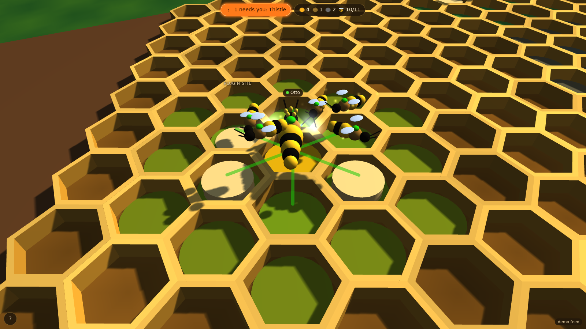
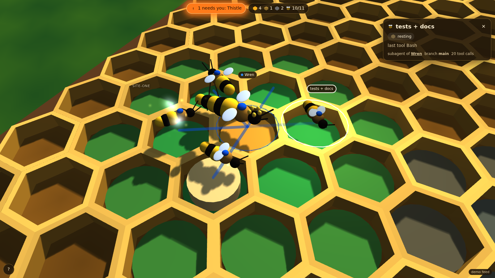
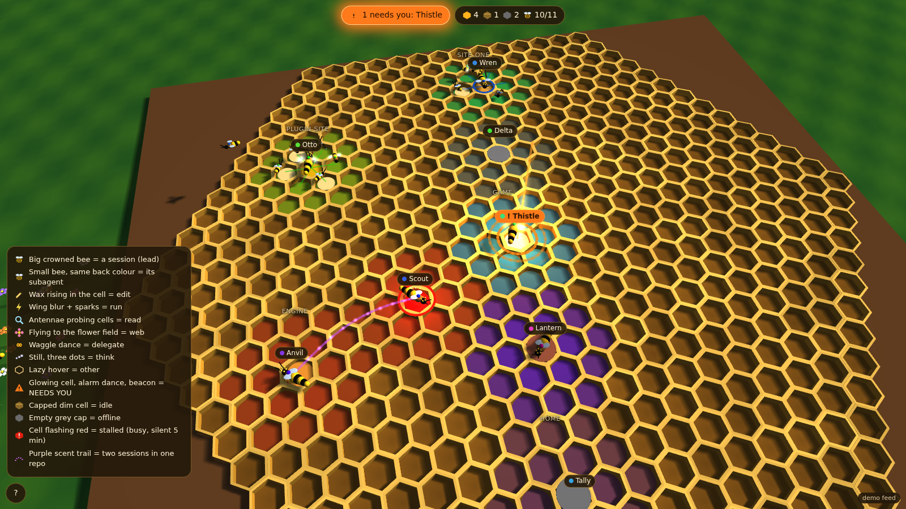
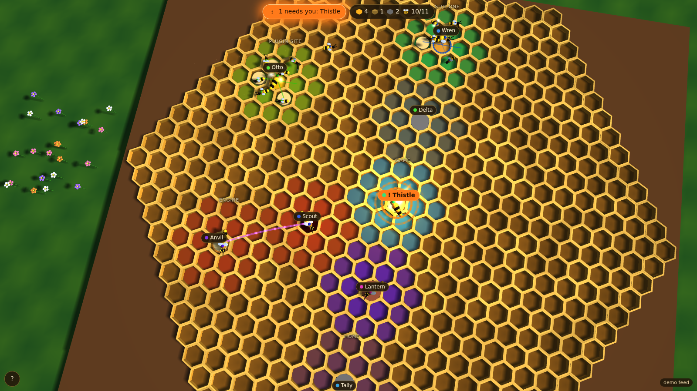

# agentviz-hive

Claude Code sessions and their subagents as bees on a honeycomb, drawn with
[Strata](https://github.com/Preponderous-Software/strata) (0.10.0 web kit).
One of the visualizations in [agentviz](https://github.com/dmccoystephenson/agentviz);
it reads only the shared agent feed (`/api/agents`).


*The whole comb from the demo feed: five repos tint five regions of cells. Thistle (centre) is waiting on
the owner, so its cell glows, rings ripple out and the pill at the top says so; Anvil and Scout share the
`engine` repo, joined by a purple scent trail.*


*Five seconds of motion: Otto's and Wren's workers building wax, buzzing, probing cells, flying loops back
to their lead and foraging at the flower field; Wren does the waggle dance.*

## The metaphor

The comb is a hex grid of wax cells, seen from above at an angle.

- **Place (repo)** = a region of cells, tinted by the place's colour. Each session owns a 19-cell patch
  (its centre plus two rings); sessions in the same repo sit side by side.
- **Session** = a large bee with a gold crown in the centre cell of its patch.
- **Subagent** = a smaller worker bee on a cell around its lead. It wears its lead's colour on its back,
  a wax bridge in that colour joins its cell to the lead's, and every few seconds an active worker flies a
  short loop out to its lead and back.

## Legend

| You see | It means | Shot |
|---|---|---|
| Big crowned bee, honey in its cell | a busy session (lead) | [hero](docs/media/hero.png) |
| Small bee wearing the same colour, bridged to the lead | its subagent | [lead + subagents](docs/media/lead-subagents.png) |
| Wax rising in the cell, bee walking the rim head down, wax flakes | `edit` | [lead + subagents](docs/media/lead-subagents.png) |
| Wing blur and sparks, hovering on the spot | `run` | [lead + subagents](docs/media/lead-subagents.png) |
| Bee walking over neighbouring cells, antennae probing down, blue tips | `read` | [lead + subagents](docs/media/lead-subagents.png) |
| Bee flying off the comb to the flower field and back, with a trail | `web` | [GIF](docs/media/hive.gif) |
| Figure-of-eight waggle dance, glowing ring in the lead's colour | `delegate` | [delegate](docs/media/lead-delegate.png) |
| Bee perfectly still, three dots over it | `think` | [shared repo](docs/media/shared-repo.png) |
| Lazy hover | `other` | |
| Cell glowing orange-white, ripples, a beacon of light, bee in a fast alarm dance, pulsing label and top pill | `waiting`: the session needs the owner | [waiting](docs/media/waiting.png) |
| Capped, dim cell, bee resting on the cap | `idle` (`dim` is darker) | [idle + offline](docs/media/idle-offline.png) |
| Empty grey cap, no bee | `offline` | [idle + offline](docs/media/idle-offline.png) |
| Cell flashing red with a red ring | `stalled`: busy but silent for 5 min | [shared repo](docs/media/shared-repo.png) |
| Dim worker sitting still on its cell, faint bridge | a resting subagent | [resting](docs/media/resting-subagent.png) |
| Glowing purple arc with drifting motes between two leads | two live sessions in the same repo (possible conflict) | [shared repo](docs/media/shared-repo.png) |

Tap or click a bee for its panel (name, state, action, current label, repo, branch, subagents; tap a
subagent in the list to jump to it). On a phone the panel is a bottom sheet. The `?` button opens the
legend in the page; the orange pill at the top, when present, selects the session that needs you.

## Screenshots

All from the demo feed (`--fixture`); never from live sessions.


*Otto (run: buzzing) with six workers on the cells around it: building wax (edit), probing cells (read),
buzzing (run). Each wears Otto's colour and is bridged to Otto's cell.*


*Wren delegating: the waggle dance on a glowing ring, its workers around it.*


*Thistle is waiting on the owner: glowing cell, ripples, a beacon column and an alarm dance.*


*Lantern is idle (a dim capped cell, the bee asleep on the cap); Tally is offline (an empty grey cap).*


*Anvil (edit) and Scout work in the same repo, so a purple scent trail joins them. Scout is thinking (still)
but has written nothing for over five minutes, so it is also stalled: its cell flashes red.*


*Wren's `tests + docs` worker is resting: dim, wings folded, a faint bridge. Selected, it shows its label.*


*The selected-agent panel: Otto's state, action, label, repo, branch and its six subagents.*


*The in-page legend (the `?` button).*

| Phone, bottom sheet | Phone, needs-you |
|---|---|
|  |  |
| *390 x 844 at DPR 3: Wren selected, the panel as a bottom sheet.* | *The needs-you pill and Thistle's beacon on a phone.* |

| Low angle | Top down |
|---|---|
|  |  |
| *A low view across the comb toward the flower field.* | *Straight down: the regions and patches as a map.* |

## Run

```bash
python3 -m vendor.agentfeed serve --web web --port 8846            # live sessions on this machine
python3 -m vendor.agentfeed serve --web web --port 8846 --fixture  # the demo feed
```

Open `http://127.0.0.1:8846/` (`?fixture=1` shows the demo feed from either mode, `?fps=1` the kit's
frame stats). Drag to orbit, right-drag or two fingers to pan, wheel or pinch to zoom.

## Build

The built `web/hive-engine.js|.wasm` and the kit scripts are committed, so serving needs only Python.
To rebuild after changing `scene/main.cpp` (emsdk 6.0.11 at `/root/emsdk`; downloads the pinned Strata
release into the gitignored `.strata/`):

```bash
scene/build.sh
```

## Test

```bash
python3 -m unittest discover -s tests -v          # serves the fixture: page, assets, feed
python3 -m vendor.agentfeed serve --web web --port 8946 --fixture &
NODE_PATH=<dir with playwright> node tests/smoke.cjs http://127.0.0.1:8946        # headless browser smoke test
NODE_PATH=<dir with playwright> node tests/screenshots.cjs http://127.0.0.1:8946  # regenerates docs/media/
```

## Layout

| Path | What |
|---|---|
| `scene/main.cpp` | The Strata scene: comb mesh, cells, bees, flowers, trails |
| `scene/kit.conf`, `scene/build.sh` | The kit build |
| `web/index.html` | Page: loader, kit, labels, panel, legend, needs-you pill |
| `web/hive.js` | Layout (patches on the comb), easing between snapshots, rows for the scene, picking |
| `vendor/agentfeed/` | The vendored feed server (do not edit; see `PIN`) |
