# agentviz-hive

Your Claude Code sessions and their subagents as bees on a honeycomb, drawn
with [Strata](https://github.com/Preponderous-Software/strata). Each session
is a big crowned bee in the middle of its own patch of cells, its subagents
are worker bees on the cells around it, and each repo tints a region of the
comb. When a session needs you, its cell glows, a beacon of light rises out of
it and the bee does an alarm dance.

One of the [agentviz](https://github.com/dmccoystephenson/agentviz) family:
several views of the same feed.

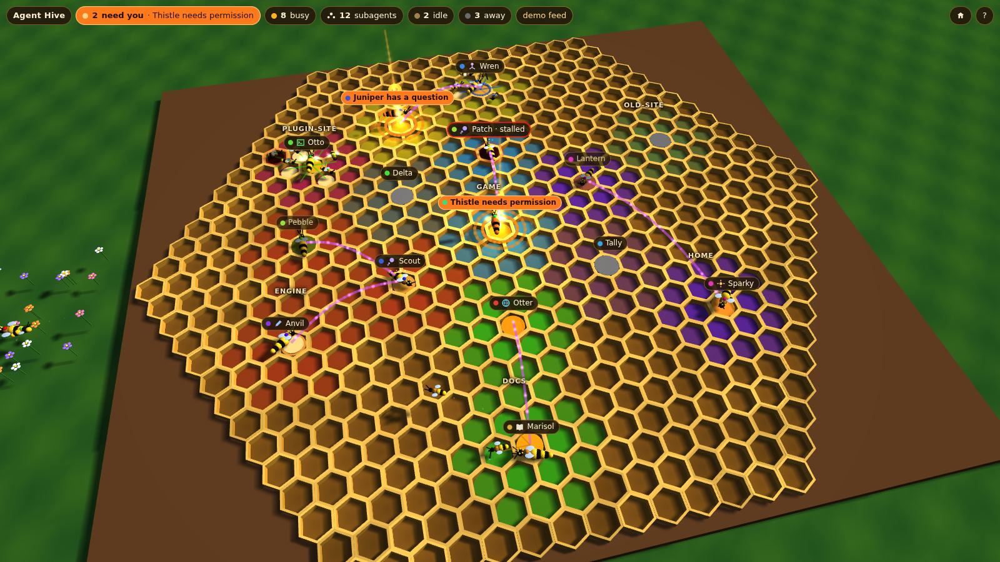
*The whole comb from the demo feed: fifteen sessions in seven repos, each repo
a colour. Thistle (needs permission) and Juniper (has a question) glow with
beacons; Patch's cell flashes red and its label says stalled; idle labels
are muted so the busy ones read first; purple scent trails join live
sessions that share a repo.*

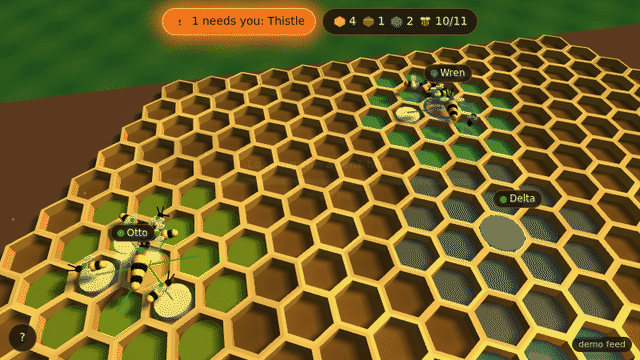
*Five seconds of motion: Wren's and Otto's workers building wax, buzzing,
probing cells, flying loops back to their lead and foraging at the flower
field; Wren does the waggle dance, and Juniper's beacon pulses between them.*

## Run

Needs Python 3.8 or newer and nothing else:

```bash
git clone https://github.com/dmccoystephenson/agentviz-hive
cd agentviz-hive
python3 -m vendor.agentfeed serve --web web --port 8846            # your live sessions
python3 -m vendor.agentfeed serve --web web --port 8846 --fixture  # the demo feed
```

Open <http://127.0.0.1:8846/> (the server binds 127.0.0.1 only and refuses
non-local `Host` headers). Live mode reads your Claude Code session files
under `~/.claude` and shows session names, states, git branches, tool names
and short labels (a file's basename, a Bash command's own description, a web
host, a subagent's description), never file contents, commands or prompts;
see the agentviz [SECURITY.md](https://github.com/dmccoystephenson/agentviz/blob/main/SECURITY.md).
Query options: `?fixture=1` (demo feed), `?fps=1` (frame stats),
`?quality=0|1|2`.

Drag to orbit, right-drag or two fingers to pan, wheel or pinch to zoom. Tap a
bee for its card (a bottom sheet on a phone, and the view slides up so the
bee you tapped stays in sight above it; swipe it down or tap the cross to
close); tap a subagent in the card to jump to it. The orange **need you** chip
names who is waiting and why (a question, or a permission prompt), flies the
camera to it and cycles through them; the house button recentres; **?** opens
the legend. If the feed stops answering, a banner says so and the last
snapshot stays; with no sessions at all, a hint says how to start. World
labels never sit under the top bar, the card or the legend; on a phone the
top bar keeps to one line (the busy and subagent counts, the chip and the
buttons).

## The metaphor

The comb is a hex grid of wax cells, seen from above at an angle.

- **Place (repo)** = a region of cells, tinted by the place's colour. Each
  session owns a 19-cell patch (its centre plus two rings); sessions in the
  same repo sit side by side.
- **Session** = a large bee with a gold crown in the centre cell of its patch.
- **Subagent** = a smaller worker bee on a cell around its lead. It wears its
  lead's colour on its back, a wax bridge in that colour joins its cell to the
  lead's, and every few seconds an active worker flies a short loop out to its
  lead and back.

## What you are looking at

| You see | It means | Close-up |
|---|---|---|
| Big crowned bee, honey in its cell | a busy session (lead) | [hero](docs/media/hero.png) |
| Deeper honey in the cell | more tool calls in that session so far | [lead + subagents](docs/media/lead-subagents.png) |
| Small bee wearing the same colour, bridged to the lead | its subagent | [lead + subagents](docs/media/lead-subagents.png) |
| A puff of pollen and a ring spreading over the cell | a new tool call, just now | |
| Wax rising in the cell, bee walking the rim head down, wax flakes | `edit` | [lead + subagents](docs/media/lead-subagents.png) |
| Wing blur and sparks, hovering on the spot | `run` | [lead + subagents](docs/media/lead-subagents.png) |
| Bee walking over neighbouring cells, antennae probing down, blue tips | `read` | [lead + subagents](docs/media/lead-subagents.png) |
| Bee flying off the comb to the flower field and back, with a trail | `web` | [GIF](docs/media/hive.gif) |
| Figure-of-eight waggle dance, glowing ring in the lead's colour | `delegate` | [delegate](docs/media/lead-delegate.png) |
| Bee perfectly still, three dots over it | `think` | [shared repo](docs/media/shared-repo.png) |
| Lazy hover | `other` | |
| Cell glowing orange-white, ripples, a beacon of light, bee in a fast alarm dance, label and chip say why | `waiting`: the session needs you | [waiting](docs/media/waiting.png) |
| A padlock / a "?" floating in the beacon | waiting on a permission prompt / on a question | [waiting](docs/media/waiting.png), [question](docs/media/question.png) |
| Capped, dim cell, bee resting on the cap, a muted label | `idle` (`dim` is darker) | [idle + offline](docs/media/idle-offline.png) |
| Empty grey cap, no bee | `offline` | [idle + offline](docs/media/idle-offline.png) |
| Cell flashing red with a red ring; a lead's label is ringed red and ends in "stalled" | `stalled`: a session busy but silent for 5 min, or a subagent quiet that long without finishing | [stalled](docs/media/stalled.png), [lead + subagents](docs/media/lead-subagents.png) |
| Dim worker sitting still on its cell, faint bridge | a resting subagent | [resting](docs/media/resting-subagent.png) |
| Glowing purple arc with drifting motes between two leads | two live sessions in the same repo (possible conflict) | [shared repo](docs/media/shared-repo.png) |

## Screenshots

All from the demo feed (`--fixture` / `?fixture=1`), never live sessions.


*Otto (run: buzzing, deep honey after 88 tool calls) with seven workers on the
cells around it: building wax (edit), probing cells (read), buzzing (run).
Each wears Otto's colour and is bridged to Otto's cell; the resting `cache
warm-up` worker has gone quiet without finishing, so its cell flashes red.*

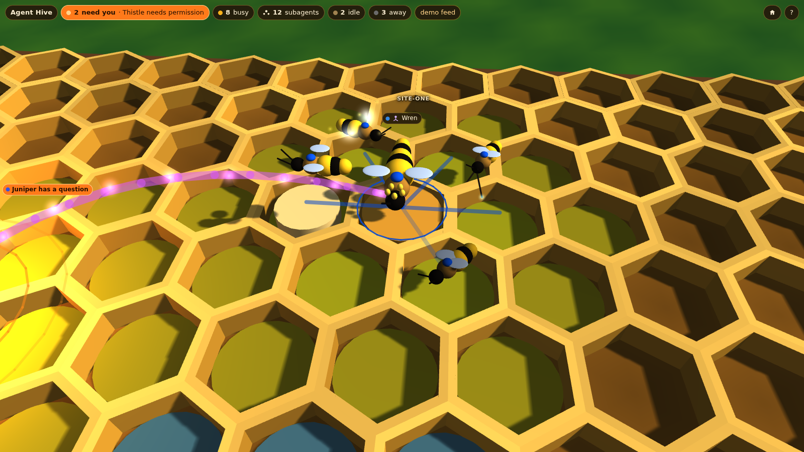
*Wren delegating: the waggle dance on a glowing ring, its workers around it.*

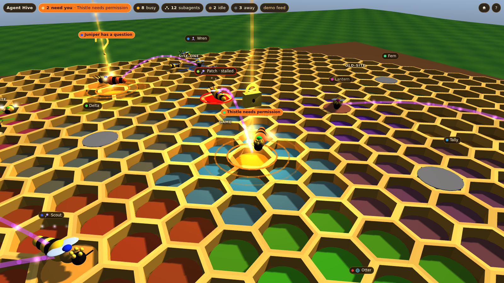
*Thistle needs permission: glowing cell, ripples, a beacon column with a
padlock in it, and an alarm dance.*

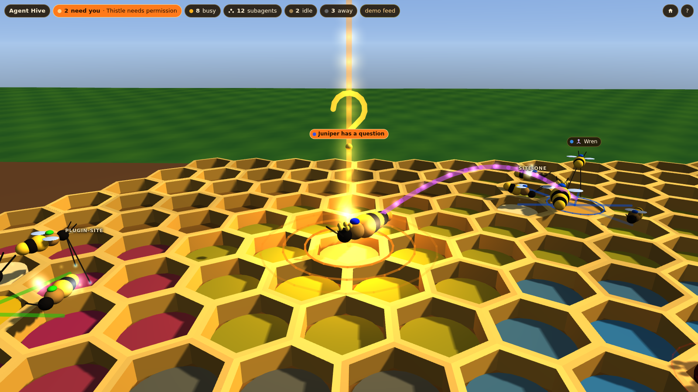
*Juniper has a question: the same beacon, with a "?" in it.*

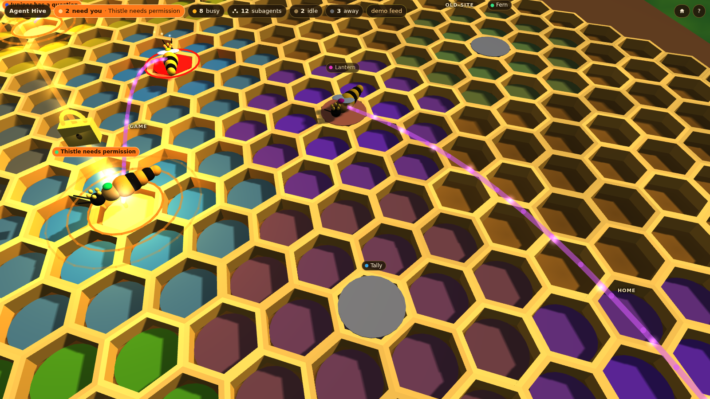
*Lantern is idle (a dim capped cell, the bee asleep on the cap); Tally is
offline (an empty grey cap).*

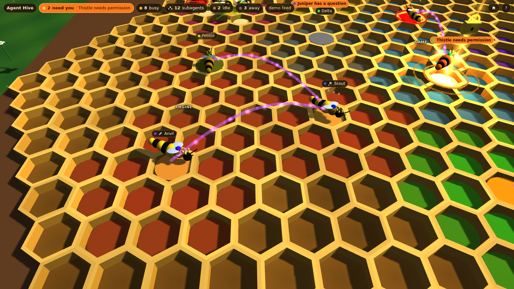
*Anvil (edit) and Scout (think: still, three dots) work in the same repo, so a
purple scent trail joins them; Pebble, a dim shell in that repo, rests on its
cap.*

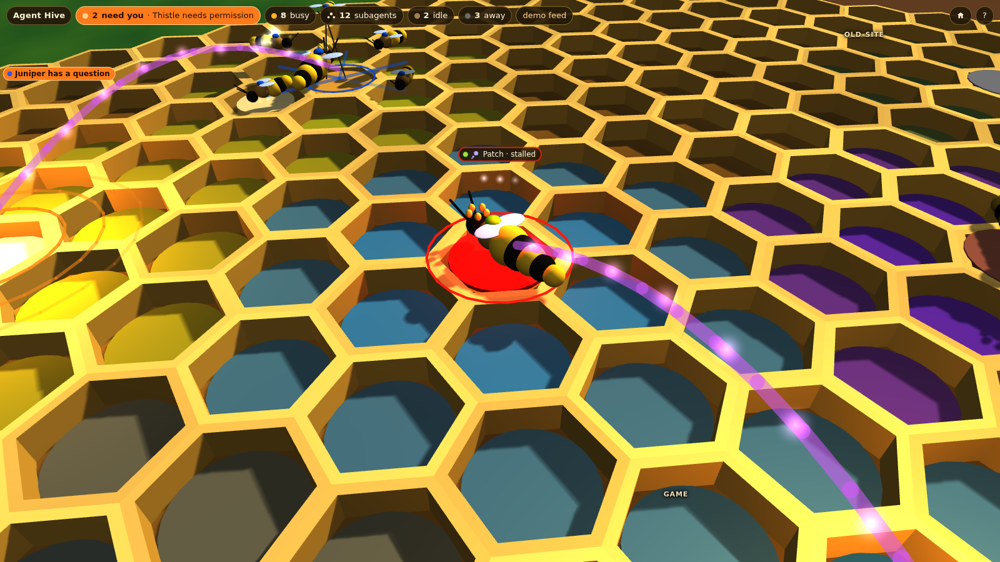
*Patch has been busy with nothing written for over five minutes: its cell
flashes red, and its label is ringed red and says "stalled".*


*Wren's `tests + docs` worker is resting: dim, wings folded, a faint bridge.
Selected, it shows its label.*

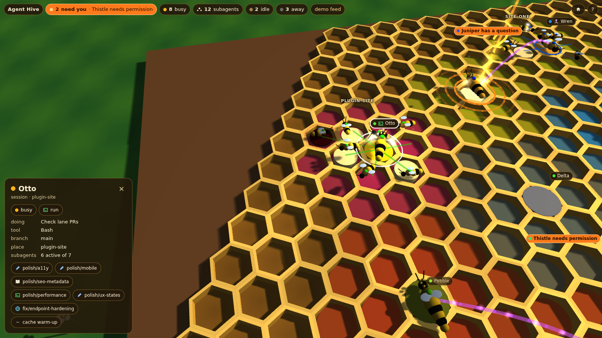
*The card for Otto: state, action, what it is doing, branch, and its seven
subagents as chips you can tap to jump to one.*


*The in-page legend (the `?` button).*

| Phone, bottom sheet | Phone, needs-you |
|---|---|
| 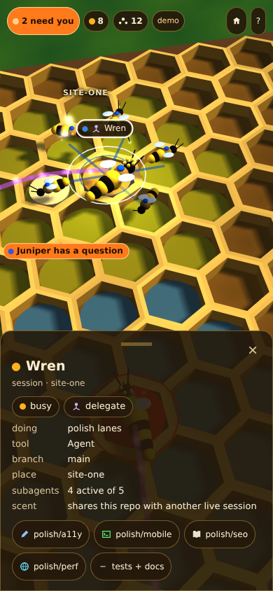 | 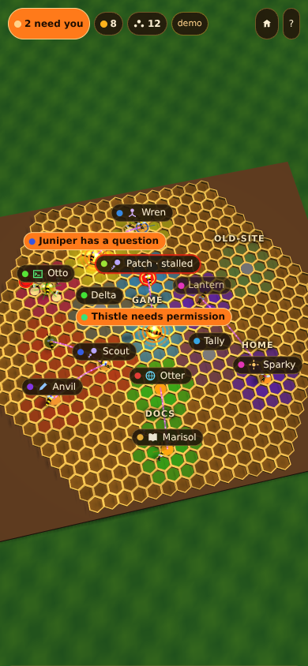 |
| *390 x 844 at DPR 3: Wren selected, the card as a bottom sheet.* | *The whole comb on a phone: a steeper view fills the height, and the top bar stays one line.* |

| Low angle | Top down |
|---|---|
| 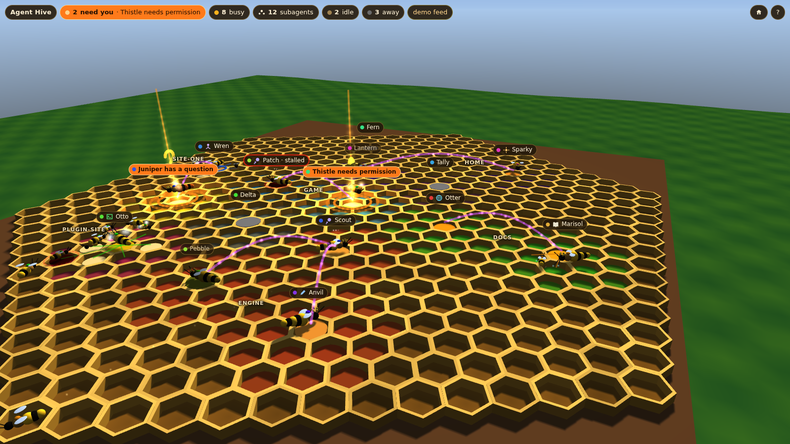 |  |
| *A low view across the comb toward the flower field.* | *Straight down: the regions and patches as a map.* |

## Build and test

```bash
python3 -m unittest discover -s tests       # serves the fixture; page, assets, feed, vendored PINs
npm ci && npx playwright install chromium   # Playwright 1.61.1, for the browser tests
pip install -r requirements-dev.txt         # Pillow, for the GIF
npm run smoke                               # headless Chromium on the demo feed; saves docs/media/screenshot.png
npm run screenshots                         # every image above (or some: npm run screenshots -- hero hive)
EMSDK=/path/to/emsdk vendor/agentviz-kit/scene/build-scene.sh scene/kit.conf   # rebuild web/hive-engine.*
```

The built engine files are committed, so serving needs only Python. The unit
tests use port 9118 (`HIVE_UNIT_PORT` overrides) and the browser tests port
9116 (`HIVE_TEST_PORT`). `vendor/agentfeed/`, `vendor/agentviz-kit/` and
`web/agentviz-*` come from [agentviz](https://github.com/dmccoystephenson/agentviz)
(`tools/vendor-kit.sh`); do not edit them here.

## How it works

The feed client, the HUD (chips, the selected-agent card and bottom sheet,
the banner), world labels, tap picking and the page-to-engine data format are
the shared agentviz kit (docs/KIT.md in agentviz). On top of it,
`web/hive-model.js` keys everything by id, gives each session a patch on the
comb (next to the rest of its repo, or a fresh region), gives each subagent a
stable cell around its lead and eases them between snapshots. Each frame
`web/hive-frame.js` packs the scene in the agentviz wire format: patches as
zones, bees as agents, scent trails as links. `scene/main.cpp` decodes it with
`agentviz.h` and draws it with Strata's primitives, lines, points and point
lights (`comb.h`, `bee.h`, `cell.h`, `props.h`).

| Path | What |
|---|---|
| `web/index.html` | The page: theme, legend, script order |
| `web/hive-model.js` | Layout on the comb and easing |
| `web/hive-frame.js` | One frame in the wire format |
| `web/page.js` | Feed, HUD, labels, picking, camera |
| `scene/*.h`, `scene/main.cpp` | The Strata scene |
| `vendor/` | agentfeed and the agentviz kit (do not edit; see each `PIN`) |

## Licence

Code: [MIT](LICENSE). Screenshots and GIFs in `docs/media/`:
[CC0 1.0](LICENSE-media). The committed engine bundles Strata (MIT) and its
libraries, and the Emscripten runtime: see
[THIRD_PARTY_NOTICES.md](THIRD_PARTY_NOTICES.md).
